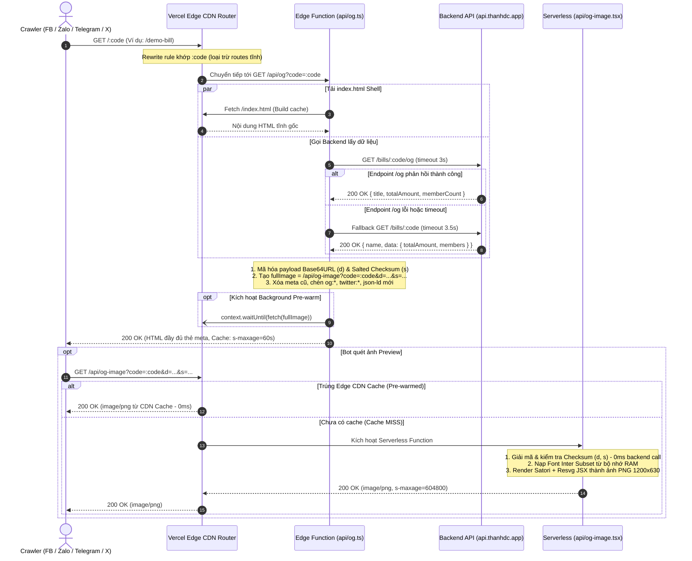

# Hướng Dẫn Tích Hợp Dynamic Open Graph & Sinh Ảnh Tự Động (Bill Splitter)

> **Mục tiêu tài liệu:** Cung cấp hướng dẫn toàn diện về kiến trúc, luồng hoạt động (flow), đặc tả kỹ thuật và mã nguồn chi tiết của hệ thống **Dynamic Open Graph & Automated Social Share Preview (Facebook, Zalo, Twitter/X, Telegram, iMessage...)** được triển khai cho dự án **Bill Splitter** (Angular SPA trên Vercel). Giải pháp kết hợp giữa **Edge Function Shell Injection**, **Serverless Dynamic OG Image Generator (@vercel/og & Satori)**, và cơ chế **Chained Pre-warming** nhằm đạt tốc độ phản hồi tức thì (TTFB < 150ms, Image Cache HIT 0ms) mà **không cần dựng Full SSR (Angular Universal)**.

---

## 1. Tổng quan bài toán & Kiến trúc giải pháp

### 1.1. Vấn đề của ứng dụng SPA truyền thống

1. **Client-side Rendering (CSR):**
   - Ứng dụng Angular SPA chỉ có duy nhất một file `index.html` tĩnh với các thẻ `<title>` và `<meta>` cố định của trang chủ.
   - Nội dung hóa đơn, số tiền, thành viên chỉ được tải và render sau khi trình duyệt tải toàn bộ các tệp JavaScript bundle về máy và thực thi.
2. **Hành vi của Crawler / Bot mạng xã hội:**
   - Các crawler mạng xã hội (Facebook `facebookexternalhit`, Zalo `ZaloBot`, Twitter `Twitterbot`, Telegram `TelegramBot`, LinkedInBot...) **không chạy JavaScript** hoặc có thời gian chờ (timeout) cực kỳ gắt gao (chỉ từ **2 đến 3 giây**).
   - Khi người dùng chia sẻ link hóa đơn (ví dụ: `https://chiatien.thanhdc.app/:code`), crawler chỉ đọc file `index.html` tĩnh rỗng ban đầu. Kết quả: bản xem trước bị trắng ảnh, hiển thị tiêu đề và mô tả mặc định của trang chủ thay vì thông tin chi tiết của hóa đơn.
3. **Tại sao không dùng Full SSR (Angular Universal / Server-Side Rendering)?**
   - Tăng độ phức tạp cho việc build, test và triển khai hệ thống.
   - Đòi hỏi server Node.js chạy liên tục để render DOM, tốn tài nguyên máy chủ và dễ gặp nguy cơ rò rỉ bộ nhớ (memory leaks).
   - Mất đi ưu thế về tốc độ phân phối toàn cầu và chi phí gần như bằng 0 của Static Hosting (Vercel CDN Edge Network).

---

### 1.2. Kiến trúc giải pháp 4 tầng (End-to-End Architecture)

Hệ thống được thiết kế theo mô hình **4 tầng tối ưu hóa**, phân tách rõ ràng giữa việc xử lý thẻ HTML meta (ở Edge) và việc render hình ảnh đồ họa (ở Serverless):

```
                       [Social Bot / Trình duyệt]
                                   │
                                   ▼
┌────────────────────────────────────────────────────────────────────────┐
│ 1. Vercel Edge Router / CDN Rewrites (vercel.json)                     │
│    ├─ Tĩnh / Assets / Fixed routes (/bills, /setting) ─► CDN Cache     │
│    └─ Đường dẫn chia sẻ hóa đơn (/:code)                               │
└──────────────────────────────────┬─────────────────────────────────────┘
                                   │
                                   ▼
┌────────────────────────────────────────────────────────────────────────┐
│ 2. Edge Function Proxy Shell Injection (api/og.ts) [Edge Runtime]       │
│    ├─ 1. Tải tĩnh file `index.html` shell (từ Vercel build cache)      │
│    ├─ 2. Hai tầng truy vấn Backend API:                                │
│    │     • Fast path: GET /bills/:code/og (< 1KB, timeout 3s)          │
│    │     • Fallback:  GET /bills/:code    (timeout 3.5s)               │
│    ├─ 3. Mã hóa dữ liệu hóa đơn thành Base64URL + Salted Checksum (d,s)│
│    ├─ 4. Chèn thẻ og:*, twitter:*, Schema.org JSON-LD vào index.html   │
│    ├─ 5. Chained Pre-warming: context.waitUntil(fetch(ogMeta.image))   │
│    └─ 6. Trả về HTML đã hoàn thiện thẻ Meta (TTFB ~100ms, s-maxage=60s)│
└──────────────────┬───────────────────────────────┬─────────────────────┘
                   │                               │
    (Link ảnh og:image trong thẻ meta)             │ (Khi có request cào dữ liệu)
                   │                               │
                   ▼                               ▼
┌──────────────────────────────────────┐  ┌──────────────────────────────┐
│ 3. Dynamic OG Image Generator        │  │ 4. Backend REST API          │
│    (api/og-image.tsx)                │  │    (https://api.thanhdc.app) │
│    [Node.js Serverless Function]     │  │                              │
│    ├─ Zero Backend Call:             │  │  ├─ GET /bills/:code/og      │
│    │  Giải mã & verify payload (d, s)│  │  │  (Chuyên dụng cho OG)     │
│    ├─ In-memory Inter Subset fonts   │  │  │                           │
│    ├─ 100% Inline SVG Vector Icons   │  │  └─ GET /bills/:code         │
│    ├─ Phẳng hóa layout (No blur)     │  │     (Chi tiết hóa đơn đầy đủ)│
│    └─ Header Cache 7 ngày            │  └──────────────────────────────┘
│       s-maxage=604800                │
└──────────────────────────────────────┘
```

#### Ưu điểm vượt trội của giải pháp:
- **Tốc độ cực nhanh (TTFB ~100–150ms):** Không render Angular DOM trên server; chỉ đọc file HTML tĩnh và replace chuỗi.
- **Tối ưu hóa ảnh sinh động (Zero Backend IO):** `api/og-image.tsx` nhận trực tiếp dữ liệu đã mã hóa từ Edge Function qua tham số `d` và `s`. Serverless Function không bao giờ phải gọi ngược lại backend lần thứ hai để lấy dữ liệu.
- **Cache CDN 7 ngày kết hợp tự động Cache-Busting:** URL ảnh chứa chữ ký và dữ liệu nội dung (`d`, `s`). Khi dữ liệu hóa đơn thay đổi, URL ảnh tự đổi, CDN tự động lưu bản mới mà không cần can thiệp thủ công.
- **Chained Pre-warming:** Ngay khi người dùng mở hộp thoại chia sẻ ở giao diện Angular, request làm ấm cache được kích hoạt ngầm. Đến khi bot mạng xã hội cào link thì cả HTML và ảnh đều đạt **100% Cache HIT (0ms render time)**.
- **Fallback an toàn 100%:** Nếu Backend API gặp sự cố hoặc timeout, Edge Function vẫn trả về file `index.html` nguyên bản. Trình duyệt người dùng vẫn mở ứng dụng bình thường và Angular Router sẽ tự xử lý giao diện báo lỗi.

---

## 2. Sơ đồ luồng hoạt động (Sequence Flow)

### 2.1. Luồng Crawler mạng xã hội truy cập link chia sẻ (`/:code`)



---

### 2.2. Luồng Angular Client tương tác & Chia sẻ

Khi người dùng thao tác trong Web SPA:
1. **Xem chi tiết hóa đơn:** Angular Router kích hoạt component xem hóa đơn. `SeoService` (`src/app/services/seo.service.ts`) cập nhật thẻ `<title>`, `<meta name="description">` và các thẻ `og:*` trong DOM client để đảm bảo bookmark hoặc extension trình duyệt luôn đồng bộ.
2. **Bấm nút "Chia sẻ":** `BillShareService` (`src/app/services/bill-share.service.ts`):
   - Kích hoạt hàm `prewarm(code)` gửi request ngầm độ ưu tiên thấp (`mode: 'no-cors'`) đến `/api/og?code=:code`.
   - Edge Function `api/og.ts` tiếp nhận và kích hoạt tiếp `fetch(ogMeta.image)` vào Edge CDN.
   - Sau đó mở Native Web Share sheet (hoặc copy link nếu trình duyệt không hỗ trợ). Nhờ đó, trước khi người dùng kịp gửi link sang Zalo/Facebook, toàn bộ dữ liệu preview đã được làm ấm trên CDN.

---

## 3. Đặc tả Backend OG Endpoint

### 3.1. Nguyên tắc thiết kế
1. **Công khai (Public):** Không yêu cầu Bearer token hoặc Session cookie để crawler bot có thể truy cập tự do.
2. **Kích thước siêu nhỏ (< 1KB):** Không trả về danh sách chi tiết các khoản chi tiêu (expenses), lịch sử chỉnh sửa hay hình ảnh hóa đơn nặng.
3. **Database Indexing:** Bắt buộc có index tìm kiếm theo `code` (ví dụ: `UNIQUE INDEX idx_bills_code ON bills(code)`), đảm bảo tốc độ query < 15ms.
4. **Header HTTP Cache:**
   ```http
   Cache-Control: public, s-maxage=60, stale-while-revalidate=300
   ```

### 3.2. Response Contract chuẩn

```typescript
export interface IBackendOgResponse {
  /** Mã định danh hóa đơn (slug/code) */
  code: string;
  /** Tiêu đề hiển thị (nếu có cấu hình riêng) */
  title?: string;
  /** Mô tả ngắn (nếu có cấu hình riêng) */
  description?: string;
  /** Tên hóa đơn */
  name?: string;
  /** Tổng số tiền của hóa đơn (VND) */
  totalAmount?: number;
  /** Số lượng thành viên tham gia chia tiền */
  memberCount?: number;
  /** Đường dẫn ảnh đại diện tùy chỉnh (nếu có) */
  image?: string;
  /** MIME type của ảnh tùy chỉnh */
  imageType?: string;
}
```

### 3.3. Cơ chế Fallback 2 tầng tại Edge Function

Để đảm bảo tính tương thích ngược và không làm gián đoạn hệ thống khi Backend chưa kịp triển khai endpoint `/og`:

| Thứ tự | Endpoint gọi tới | Điều kiện kích hoạt | Mục đích |
| :--- | :--- | :--- | :--- |
| **Tầng 1 (Chính)** | `GET /bills/:code/og` | Luôn gọi trước tiên (timeout 3.0s) | Lấy dữ liệu OG siêu nhẹ chuyên dụng. |
| **Tầng 2 (Dự phòng)** | `GET /bills/:code` | Khi Tầng 1 trả về mã lỗi 404/500 hoặc timeout | Sử dụng endpoint chi tiết hóa đơn sẵn có, tự trích xuất `totalAmount = data.totalAmount` và `memberCount = data.members.length`. |

### 3.4. Ma trận xác định thông tin thẻ Meta

| Thuộc tính | Nguồn ưu tiên 1 | Nguồn ưu tiên 2 | Fallback mặc định |
| :--- | :--- | :--- | :--- |
| **`title`** | `bill.title` | `Hóa đơn: ${bill.name} — Bill Splitter` | `Bill Splitter — Bạn cứ chill – bill tôi chia` |
| **`description`** | `bill.description` | `Tổng tiền: ${formatCurrency(amount)} • ${count} người tham gia • Bấm để xem chi tiết và quét QR thanh toán.` | `Xem chi tiết hóa đơn ${code} trên Bill Splitter.` |
| **`image`** | Dynamic OG Image URL (`/api/og-image?code=...&d=...&s=...`) | Ảnh đính kèm của hóa đơn (`bill.image`) | Ảnh tĩnh hệ thống (`/thumbnail.webp`) |

---

## 4. Chi tiết triển khai Hệ thống tại Codebase

### 4.1. Cấu hình Rewrite URL Vercel (`vercel.json`)

File `vercel.json` định nghĩa các quy tắc điều hướng, bao gồm regex loại trừ các đường dẫn tĩnh cố định để chuyển hướng chính xác các mã hóa đơn `/:code` về Edge Function:

```json
{
  "$schema": "https://openapi.vercel.sh/vercel.json",
  "framework": "angular",
  "installCommand": "npm ci",
  "buildCommand": "npm run build:prod",
  "outputDirectory": "dist/browser",
  "functions": {
    "api/og-image.tsx": {
      "includeFiles": "api/**"
    }
  },
  "rewrites": [
    {
      "source": "/api/(.*)",
      "destination": "/api/$1"
    },
    {
      "source": "/:code((?!bills$|setting$|auth(?:/.*)?$|images/|icons/|favicon\\.png$|manifest\\.webmanifest$|robots\\.txt$|sitemap\\.xml$|thumbnail\\.webp$|api/|.*\\.(?:js|css|woff2?|png|jpg|webp|ico|svg|json)$).*)",
      "destination": "/api/og?code=:code"
    },
    {
      "source": "/(.*)",
      "destination": "/index.html"
    }
  ],
  "headers": [
    {
      "source": "/index.html",
      "headers": [{ "key": "Cache-Control", "value": "no-cache" }]
    },
    {
      "source": "/(chunk|main|polyfills|styles)-(.*)\\.(js|css)",
      "headers": [{ "key": "Cache-Control", "value": "public, max-age=31536000, immutable" }]
    }
  ]
}
```

---

### 4.2. Cơ chế Mã hóa Payload & Salted Checksum (`api/_lib/og-payload.ts`)

Module cung cấp tính năng mã hóa dữ liệu thành chuỗi Base64URL gọn gàng và tạo chữ ký kiểm tra (checksum 64-bit) nhằm tránh giả mạo dữ liệu hóa đơn qua URL:

```typescript
export interface IOgPayload {
  c: string;  // mã hóa đơn (code)
  n?: string; // tên hóa đơn (name/title)
  a?: number; // tổng tiền (amount)
  m?: number; // số người tham gia (members count)
  v?: number; // phiên bản / revision hash
}

const DEFAULT_OG_SALT = 'bill-splitter-og-salt-2026';

export function toBase64Url(str: string): string {
  const bytes = new TextEncoder().encode(str);
  let binary = '';
  for (let i = 0; i < bytes.byteLength; i++) {
    binary += String.fromCharCode(bytes[i]);
  }
  return btoa(binary).replace(/\+/g, '-').replace(/\//g, '_').replace(/=+$/, '');
}

export function fromBase64Url(base64url: string): string {
  let base64 = base64url.replace(/-/g, '+').replace(/_/g, '/');
  while (base64.length % 4) base64 += '=';
  const binary = atob(base64);
  const bytes = new Uint8Array(binary.length);
  for (let i = 0; i < binary.length; i++) {
    bytes[i] = binary.charCodeAt(i);
  }
  return new TextDecoder().decode(bytes);
}

/** Tạo Checksum 64-bit sử dụng thuật toán Murmur/Mix hash có muối bí mật */
export function computeChecksumSync(
  str: string,
  salt = (typeof process !== 'undefined' && process.env?.['OG_SECRET']) || DEFAULT_OG_SALT
): string {
  let h1 = 0xdeadbeef ^ 0;
  let h2 = 0x41c6ce57 ^ 0;
  const combined = `${salt}:${str}`;
  for (let i = 0; i < combined.length; i++) {
    const ch = combined.charCodeAt(i);
    h1 = Math.imul(h1 ^ ch, 2654435761);
    h2 = Math.imul(h2 ^ ch, 1597334677);
  }
  h1 = Math.imul(h1 ^ (h1 >>> 16), 2246822507);
  h1 ^= Math.imul(h2 ^ (h2 >>> 13), 3266489909);
  h2 = Math.imul(h2 ^ (h2 >>> 16), 2246822507);
  h2 ^= Math.imul(h1 ^ (h1 >>> 13), 3266489909);
  const val = 4294967296 * (2097151 & h2) + (h1 >>> 0);
  return val.toString(36);
}

export function encodeOgPayload(payload: IOgPayload, salt?: string): { d: string; s: string } {
  const jsonStr = JSON.stringify(payload);
  const d = toBase64Url(jsonStr);
  const s = computeChecksumSync(d, salt);
  return { d, s };
}

export function decodeAndVerifyOgPayload(d: string, s: string, salt?: string): IOgPayload | null {
  if (!d || !s) return null;
  const expectedSig = computeChecksumSync(d, salt);
  if (expectedSig !== s) return null;

  try {
    const jsonStr = fromBase64Url(d);
    const parsed = JSON.parse(jsonStr) as IOgPayload;
    if (typeof parsed !== 'object' || parsed === null) return null;
    return parsed;
  } catch {
    return null;
  }
}
```

---

### 4.3. Thư viện Dựng Meta & Shell Injection (`api/_lib/og-meta.ts`)

File hỗ trợ chuyển đổi dữ liệu thành các thẻ Open Graph, Twitter Cards, Schema.org JSON-LD và dọn dẹp các thẻ trùng lặp trong `index.html`:

```typescript
import { encodeOgPayload, type IOgPayload } from './og-payload.js';

export interface IOgMeta {
  title: string;
  description: string;
  url: string;
  image: string;
  imageType?: string;
  jsonLd?: string;
}

export interface IBillDataInput {
  code: string;
  name?: string;
  title?: string;
  description?: string;
  totalAmount?: number;
  memberCount?: number;
  image?: string;
  imageType?: string;
}

export const SITE_NAME = 'Bill Splitter';
export const DEFAULT_DESCRIPTION = 'Bạn cứ chill – bill tôi chia';

export function formatCurrency(amount: number): string {
  if (typeof amount !== 'number' || isNaN(amount)) return '0 ₫';
  return new Intl.NumberFormat('vi-VN', {
    style: 'currency',
    currency: 'VND',
    maximumFractionDigits: 0,
  }).format(amount);
}

export function escapeHtml(value: string): string {
  return value
    .replace(/&/g, '&amp;')
    .replace(/</g, '&lt;')
    .replace(/>/g, '&gt;')
    .replace(/"/g, '&quot;')
    .replace(/'/g, '&#39;');
}

export function buildBillOgMeta(bill: IBillDataInput, origin: string): IOgMeta {
  const cleanOrigin = origin.replace(/\/+$/, '');
  const billCode = bill.code.trim();
  const pageUrl = `${cleanOrigin}/${encodeURIComponent(billCode)}`;

  // 1. Xác định Title
  let title = bill.title?.trim();
  if (!title) {
    title = bill.name?.trim()
      ? `Hóa đơn: ${bill.name.trim()} — ${SITE_NAME}`
      : `${SITE_NAME} — ${DEFAULT_DESCRIPTION}`;
  }

  // 2. Xác định Description
  let description = bill.description?.trim();
  if (!description) {
    if (typeof bill.totalAmount === 'number' && bill.totalAmount > 0) {
      const parts = [`Tổng tiền: ${formatCurrency(bill.totalAmount)}`];
      if (typeof bill.memberCount === 'number' && bill.memberCount > 0) {
        parts.push(`${bill.memberCount} người tham gia`);
      }
      parts.push('Bấm để xem chi tiết và quét QR thanh toán.');
      description = parts.join(' • ');
    } else {
      description = `Xem chi tiết hóa đơn ${bill.name || billCode} trên ${SITE_NAME}.`;
    }
  }

  // 3. Tạo Dynamic OG Image URL có chứa d & s
  let fullImage = '';
  let imageType = 'image/png';

  if (billCode) {
    const payload: IOgPayload = { c: billCode };
    const nameToPass = bill.name?.trim() || bill.title?.trim();
    if (nameToPass) payload.n = nameToPass;
    if (typeof bill.totalAmount === 'number' && bill.totalAmount > 0) payload.a = bill.totalAmount;
    if (typeof bill.memberCount === 'number' && bill.memberCount > 0) payload.m = bill.memberCount;

    const { d, s } = encodeOgPayload(payload);
    fullImage = `${cleanOrigin}/api/og-image?code=${encodeURIComponent(billCode)}&d=${encodeURIComponent(d)}&s=${encodeURIComponent(s)}`;
    imageType = 'image/png';
  } else {
    fullImage = `${cleanOrigin}/thumbnail.webp`;
    imageType = 'image/webp';
  }

  // 4. Schema.org JSON-LD
  const jsonLdObj = {
    '@context': 'https://schema.org',
    '@type': 'WebPage',
    name: title,
    description: description.slice(0, 300),
    url: pageUrl,
    image: [fullImage],
  };

  return {
    title,
    description: description.slice(0, 300),
    url: pageUrl,
    image: fullImage,
    imageType,
    jsonLd: JSON.stringify(jsonLdObj).replace(/<\/script/gi, '<\\/script'),
  };
}

export function injectOgMeta(html: string, meta: IOgMeta): string {
  const t = escapeHtml(meta.title);
  const d = escapeHtml(meta.description);
  const u = escapeHtml(meta.url);
  const i = meta.image ? escapeHtml(meta.image) : '';
  const it = meta.imageType || 'image/png';

  const newTags = [
    `<meta property="og:type" content="website">`,
    `<meta property="og:site_name" content="${SITE_NAME}">`,
    `<meta property="og:locale" content="vi_VN">`,
    `<meta property="og:url" content="${u}">`,
    `<meta property="og:title" content="${t}">`,
    `<meta property="og:description" content="${d}">`,
    i && `<meta property="og:image" content="${i}">`,
    i && `<meta property="og:image:secure_url" content="${i}">`,
    i && `<meta property="og:image:type" content="${it}">`,
    i && `<meta property="og:image:width" content="1200">`,
    i && `<meta property="og:image:height" content="630">`,
    i && `<meta property="og:image:alt" content="${t}">`,
    `<meta name="twitter:card" content="summary_large_image">`,
    `<meta name="twitter:title" content="${t}">`,
    `<meta name="twitter:description" content="${d}">`,
    i && `<meta name="twitter:image" content="${i}">`,
    `<link rel="canonical" href="${u}">`,
    meta.jsonLd && `<script type="application/ld+json">${meta.jsonLd}</script>`,
  ].filter(Boolean).join('\n  ');

  // Xóa các thẻ tĩnh cũ trong index.html để tránh trùng lặp
  const cleanHtml = html
    .replace(/<title>[\s\S]*?<\/title>/i, () => `<title>${t}</title>`)
    .replace(/<meta\s+name=["']description["'][^>]*>/gi, '')
    .replace(/<meta\s+name=["']title["'][^>]*>/gi, '')
    .replace(/<meta\s+(property|name)=["']og:[^"']+["'][^>]*>/gi, '')
    .replace(/<meta\s+(property|name)=["']twitter:[^"']+["'][^>]*>/gi, '')
    .replace(/<link\s+rel=["']canonical["'][^>]*>/gi, '')
    .replace(/<script\s+type=["']application\/ld\+json["'][\s\S]*?<\/script>/gi, '');

  return cleanHtml.replace('</head>', () => `  <meta name="description" content="${d}">\n  ${newTags}\n</head>`);
}
```

---

### 4.4. Edge Function Handler (`api/og.ts`)

File đóng vai trò tiếp nhận request từ rewrite `/:code`, truy vấn backend, chèn thẻ meta và kích hoạt background pre-warming:

```typescript
import { buildBillOgMeta, injectOgMeta, type IBillDataInput } from './_lib/og-meta.js';

export const config = {
  runtime: 'edge',
};

const DEFAULT_API_BASE_URL = 'https://api.thanhdc.app';
const CODE_PATTERN = /^[a-zA-Z0-9_-]{1,64}$/;
const RESERVED_ROUTES = new Set(['bills', 'setting', 'auth', 'api']);

const CACHE_HEADERS = {
  'content-type': 'text/html; charset=utf-8',
  'cache-control': 'public, s-maxage=60, stale-while-revalidate=300',
};

interface IRequestContext {
  waitUntil?: (promise: Promise<unknown>) => void;
}

export async function GET(request: Request, context?: IRequestContext): Promise<Response> {
  const requestUrl = new URL(request.url);
  const host = request.headers.get('x-forwarded-host') ?? requestUrl.host;
  const proto = request.headers.get('x-forwarded-proto') ?? 'https';
  const origin = `${proto}://${host}`;
  const code = (requestUrl.searchParams.get('code') ?? '').trim();

  // 1. Tải file index.html đã build
  const shellHeaders: Record<string, string> = { cookie: request.headers.get('cookie') ?? '' };
  const bypass = process.env['VERCEL_AUTOMATION_BYPASS_SECRET'];
  if (bypass) shellHeaders['x-vercel-protection-bypass'] = bypass;

  const shell = await fetch(`${origin}/index.html`, { headers: shellHeaders });
  if (!shell.ok) return new Response('index.html unavailable', { status: 502 });
  const html = await shell.text();

  // Validate code cơ bản
  if (!code || !CODE_PATTERN.test(code) || RESERVED_ROUTES.has(code.toLowerCase())) {
    return new Response(html, { status: 200, headers: CACHE_HEADERS });
  }

  const apiBase = (process.env['API_BASE_URL']?.trim() || DEFAULT_API_BASE_URL).replace(/\/+$/, '');

  try {
    let billInput: IBillDataInput | null = null;

    // 2a. Thử gọi Backend OG Endpoint chuyên dụng trước (GET /bills/:code/og)
    try {
      const ogRes = await fetch(`${apiBase}/bills/${encodeURIComponent(code)}/og`, {
        headers: { accept: 'application/json' },
        signal: AbortSignal.timeout(3000),
      });

      if (ogRes.ok) {
        const ogData = await ogRes.json();
        billInput = {
          code: ogData.code || code,
          title: ogData.title,
          description: ogData.description,
          name: ogData.name,
          totalAmount: ogData.totalAmount,
          memberCount: ogData.memberCount,
          image: ogData.image,
          imageType: ogData.imageType,
        };
      }
    } catch {
      billInput = null;
    }

    // 2b. Nếu chưa có từ /og, fallback sang endpoint hiện có: GET /bills/:code
    if (!billInput) {
      const billRes = await fetch(`${apiBase}/bills/${encodeURIComponent(code)}`, {
        headers: { accept: 'application/json' },
        signal: AbortSignal.timeout(3500),
      });

      if (billRes.status === 404) {
        return new Response(html, { status: 404, headers: CACHE_HEADERS });
      }

      if (!billRes.ok) {
        return new Response(html, { status: 200, headers: CACHE_HEADERS });
      }

      const billData = await billRes.json();
      billInput = {
        code,
        name: billData.name,
        totalAmount: billData.data?.totalAmount ?? 0,
        memberCount: billData.data?.members?.length ?? 0,
        image: billData.files?.[0]?.storagePath,
      };
    }

    // 3. Inject thẻ meta động vào index.html
    const ogMeta = buildBillOgMeta(billInput, origin);
    const enrichedHtml = injectOgMeta(html, ogMeta);

    // 4. Chained Pre-warming: Kích hoạt sinh trước ảnh OG đầy đủ tham số vào Edge CDN
    if (ogMeta.image && ogMeta.image.startsWith(origin)) {
      const prewarmPromise = fetch(ogMeta.image).catch(() => undefined);
      if (context && typeof context.waitUntil === 'function') {
        context.waitUntil(prewarmPromise);
      }
    }

    return new Response(enrichedHtml, {
      status: 200,
      headers: CACHE_HEADERS,
    });
  } catch (err) {
    // 5. Fallback an toàn: Trả HTML gốc không crash
    console.error('Lỗi khi tải thông tin OG cho bill:', err);
    return new Response(html, {
      status: 200,
      headers: { ...CACHE_HEADERS, 'cache-control': 'no-store' },
    });
  }
}

export async function HEAD(request: Request, context?: IRequestContext): Promise<Response> {
  const res = await GET(request, context);
  return new Response(null, { status: res.status, headers: res.headers });
}
```

---

### 4.5. Dynamic OG Image Generator (`api/og-image.tsx`)

Serverless Function chạy trên Vercel Node.js runtime, sử dụng `@vercel/og` (Satori + Resvg) để render ảnh biên nhận 1200x630 pixel:

```tsx
import React from 'react';
import { ImageResponse } from '@vercel/og';
import { decodeAndVerifyOgPayload } from './_lib/og-payload.js';
import { getInterFonts } from './_fonts/inter-subset.js';

function ReceiptIcon() {
  return (
    <svg width="38" height="38" viewBox="0 0 24 24" fill="none" stroke="#1B6B72" strokeWidth="2" strokeLinecap="round" strokeLinejoin="round">
      <path d="M4 2v20l2-1 2 1 2-1 2 1 2-1 2 1 2-1 2 1 2-1 2 1V2l-2 1-2-1-2 1-2-1-2 1-2-1-2 1Z" fill="#E0F2F1" />
      <path d="M16 8h-8" />
      <path d="M16 12h-8" />
      <path d="M13 16h-5" />
    </svg>
  );
}

function PointerIcon() {
  return (
    <svg width="18" height="18" viewBox="0 0 24 24" fill="none" stroke="#0D9488" strokeWidth="2.2" strokeLinecap="round" strokeLinejoin="round" style={{ marginRight: '8px' }}>
      <circle cx="12" cy="12" r="10" />
      <polyline points="12 16 16 12 12 8" />
      <line x1="8" y1="12" x2="16" y2="12" />
    </svg>
  );
}

function formatVND(amount: number): string {
  if (typeof amount !== 'number' || isNaN(amount)) return '0 đ';
  return new Intl.NumberFormat('vi-VN', { maximumFractionDigits: 0 }).format(amount) + ' đ';
}

export async function GET(request: Request): Promise<Response> {
  const { searchParams } = new URL(request.url);
  const d = searchParams.get('d') ?? '';
  const s = searchParams.get('s') ?? '';
  let code = (searchParams.get('code') ?? '').trim();

  let billName = 'Hóa đơn chia tiền';
  let totalAmount = 0;
  let memberCount = 0;
  let hasData = false;

  // 1. Giải mã payload Base64URL + Checksum (Fast path - 0 backend call)
  const verifiedPayload = decodeAndVerifyOgPayload(d, s);
  if (verifiedPayload) {
    if (verifiedPayload.c) code = verifiedPayload.c;
    if (verifiedPayload.n?.trim()) billName = verifiedPayload.n.trim();
    if (typeof verifiedPayload.a === 'number') totalAmount = verifiedPayload.a;
    if (typeof verifiedPayload.m === 'number') memberCount = verifiedPayload.m;
    hasData = Boolean(verifiedPayload.n) || totalAmount > 0 || memberCount > 0;
  }

  const displayTitle = billName.length > 55 ? `${billName.slice(0, 52)}...` : billName;
  const isCachedLong = hasData && Boolean(code);
  const cacheControl = isCachedLong
    ? 'public, s-maxage=604800, stale-while-revalidate=86400'
    : 'public, s-maxage=60, stale-while-revalidate=300';

  const fonts = getInterFonts();

  return new ImageResponse(
    (
      <div
        style={{
          width: '100%',
          height: '100%',
          display: 'flex',
          flexDirection: 'column',
          alignItems: 'center',
          justifyContent: 'center',
          backgroundColor: '#0F172A',
          backgroundImage: 'linear-gradient(135deg, #0F172A 0%, #16383E 50%, #0F172A 100%)',
          fontFamily: 'Inter, sans-serif',
          padding: '40px',
        }}
      >
        <div
          style={{
            width: '1060px',
            height: '540px',
            display: 'flex',
            flexDirection: 'column',
            backgroundColor: '#FFFFFF',
            borderRadius: '24px',
            border: '2px solid rgba(27, 107, 114, 0.3)',
            outline: '6px solid rgba(255, 255, 255, 0.08)',
            overflow: 'hidden',
          }}
        >
          {/* Header Card */}
          <div
            style={{
              display: 'flex',
              alignItems: 'center',
              justifyContent: 'space-between',
              padding: '24px 44px',
              backgroundColor: '#F8FAFC',
              borderBottom: '2px dashed #CBD5E1',
            }}
          >
            <div style={{ display: 'flex', alignItems: 'center', gap: '14px' }}>
              <ReceiptIcon />
              <div style={{ display: 'flex', flexDirection: 'column' }}>
                <span style={{ fontSize: '26px', fontWeight: 700, color: '#1B6B72', letterSpacing: '-0.5px' }}>
                  Bill Splitter
                </span>
                <span style={{ fontSize: '14px', color: '#64748B', fontWeight: 500 }}>
                  Bạn cứ chill – bill tôi chia
                </span>
              </div>
            </div>

            {code ? (
              <div
                style={{
                  display: 'flex',
                  alignItems: 'center',
                  padding: '8px 18px',
                  backgroundColor: '#E0F2F1',
                  borderRadius: '30px',
                  border: '1px solid #80CBC4',
                }}
              >
                <span style={{ fontSize: '15px', fontWeight: 700, color: '#00695C', letterSpacing: '1px' }}>
                  #{code.toUpperCase()}
                </span>
              </div>
            ) : null}
          </div>

          {/* Body Card */}
          <div
            style={{
              display: 'flex',
              flexDirection: 'column',
              flex: 1,
              padding: '36px 44px 28px',
              justifyContent: 'space-between',
            }}
          >
            <div style={{ display: 'flex', flexDirection: 'column', gap: '8px' }}>
              <span style={{ fontSize: '13px', fontWeight: 700, color: '#94A3B8', letterSpacing: '1.5px', textTransform: 'uppercase' }}>
                Tên Hóa Đơn
              </span>
              <span style={{ fontSize: '34px', fontWeight: 700, color: '#0F172A', lineHeight: '1.25' }}>
                {displayTitle}
              </span>
            </div>

            {/* Khối hiển thị Tổng tiền & Thành viên */}
            <div
              style={{
                display: 'flex',
                alignItems: 'center',
                justifyContent: 'space-between',
                padding: '20px 28px',
                backgroundColor: '#F0FDFA',
                borderRadius: '16px',
                border: '1px solid #CCFBF1',
              }}
            >
              <div style={{ display: 'flex', flexDirection: 'column' }}>
                <span style={{ fontSize: '13px', fontWeight: 700, color: '#0D9488', letterSpacing: '1px', textTransform: 'uppercase' }}>
                  Tổng Tiền
                </span>
                <span style={{ fontSize: '44px', fontWeight: 700, color: '#0F766E', letterSpacing: '-1px', marginTop: '2px' }}>
                  {formatVND(totalAmount)}
                </span>
              </div>

              <div style={{ display: 'flex', gap: '32px' }}>
                <div style={{ display: 'flex', flexDirection: 'column', alignItems: 'flex-end' }}>
                  <span style={{ fontSize: '13px', color: '#64748B', fontWeight: 500 }}>Thành viên</span>
                  <span style={{ fontSize: '24px', fontWeight: 700, color: '#1E293B', marginTop: '2px' }}>
                    {hasData && memberCount > 0 ? `${memberCount} người` : '—'}
                  </span>
                </div>
                <div style={{ display: 'flex', flexDirection: 'column', alignItems: 'flex-end' }}>
                  <span style={{ fontSize: '13px', color: '#64748B', fontWeight: 500 }}>Thanh toán</span>
                  <span style={{ fontSize: '24px', fontWeight: 700, color: '#1E293B', marginTop: '2px' }}>
                    Mã QR
                  </span>
                </div>
              </div>
            </div>

            {/* Footer Card */}
            <div
              style={{
                display: 'flex',
                alignItems: 'center',
                justifyContent: 'space-between',
                borderTop: '1px solid #E2E8F0',
                paddingTop: '16px',
              }}
            >
              <div style={{ display: 'flex', alignItems: 'center' }}>
                <PointerIcon />
                <span style={{ fontSize: '16px', fontWeight: 500, color: '#0D9488' }}>
                  Bấm vào để xem chi tiết tiền chia & quét mã QR
                </span>
              </div>
              <span style={{ fontSize: '15px', fontWeight: 700, color: '#64748B' }}>
                chiatien.thanhdc.app
              </span>
            </div>
          </div>
        </div>
      </div>
    ),
    {
      width: 1200,
      height: 630,
      ...(fonts.length > 0 ? { fonts } : {}),
      headers: {
        'content-type': 'image/png',
        'cache-control': cacheControl,
        'cdn-cache-control': cacheControl,
        'vercel-cdn-cache-control': cacheControl,
      },
    }
  );
}
```

---

### 4.6. Nhúng Font Inter Subset Nhị Phân (`api/_fonts/inter-subset.ts`)

Để triệt tiêu hoàn toàn network request đến Google Fonts CDN (`fonts.gstatic.com`) và loại bỏ lỗi đường dẫn ổ đĩa `process.cwd()` trên Lambda, 2 font subset Inter (Medium 500 và Bold 700) được đóng gói trực tiếp thành chuỗi Base64 nhị phân trong file TypeScript và nạp sẵn vào RAM khi container khởi động:

```typescript
// Trích xuất cấu trúc rút gọn của api/_fonts/inter-subset.ts
const INTER_MEDIUM_BASE64 = 'AAEAAAASAQA...'; // ~59KB Base64
const INTER_BOLD_BASE64   = 'AAEAAAASAQA...'; // ~59KB Base64

function base64ToArrayBuffer(base64: string): ArrayBuffer {
  const binary = atob(base64);
  const bytes = new Uint8Array(binary.length);
  for (let i = 0; i < binary.length; i++) {
    bytes[i] = binary.charCodeAt(i);
  }
  return bytes.buffer;
}

let cachedFonts: Array<{ name: string; data: ArrayBuffer; weight: 400 | 500 | 700; style: 'normal' }> | null = null;

export function getInterFonts() {
  if (cachedFonts) return cachedFonts;
  try {
    cachedFonts = [
      { name: 'Inter', data: base64ToArrayBuffer(INTER_MEDIUM_BASE64), weight: 500, style: 'normal' },
      { name: 'Inter', data: base64ToArrayBuffer(INTER_BOLD_BASE64),   weight: 700, style: 'normal' },
    ];
    return cachedFonts;
  } catch (err) {
    console.error('Không thể nạp font Inter nhúng sẵn:', err);
    return [];
  }
}
```

---

### 4.7. Client Angular Pre-warming (`src/app/services/bill-share.service.ts`)

```typescript
import { inject, Injectable } from '@angular/core';
import { MatSnackBar } from '@angular/material/snack-bar';

@Injectable({ providedIn: 'root' })
export class BillShareService {
  private readonly snackBar = inject(MatSnackBar);

  /**
   * Pre-warm cache ngầm: Khi người dùng bấm chia sẻ, gửi request ngầm đến /api/og?code=...
   * Edge Function api/og.ts tự động kích hoạt sinh trước ảnh lên Edge CDN.
   */
  prewarm(code: string): void {
    if (!code || typeof window === 'undefined' || typeof fetch !== 'function') return;
    try {
      const origin = window.location.origin;
      const fetchOpts = { mode: 'no-cors' as RequestMode, priority: 'low' as unknown as string };
      void fetch(`${origin}/api/og?code=${encodeURIComponent(code)}`, fetchOpts as RequestInit).catch(() => undefined);
    } catch {
      // Bỏ qua lỗi ngầm
    }
  }

  async share(code: string, name?: string): Promise<void> {
    this.prewarm(code);
    const data = this.buildShareData(code, name);
    if (await this.tryNativeShare(data)) return;
    await this.copyWithShareAction(data);
  }

  private buildShareData(code: string, name?: string): ShareData {
    const url = `${window.location.origin}/${code}`;
    const title = name?.trim();
    return title ? { title, text: `Chia tiền: ${title}`, url } : { url };
  }
  // ... các hàm fallback copy clipboard
}
```

---

### 4.8. Đồng bộ Thẻ Meta tại Client (`src/app/services/seo.service.ts`)

```typescript
import { Injectable, inject } from '@angular/core';
import { DOCUMENT } from '@angular/common';
import { Meta, Title } from '@angular/platform-browser';
import { environment } from '../../environments/environment';

export interface ISeoConfig {
  title?: string;
  description?: string;
  image?: string;
  imageType?: string;
  url?: string;
  keywords?: string;
}

@Injectable({ providedIn: 'root' })
export class SeoService {
  private readonly title = inject(Title);
  private readonly meta = inject(Meta);
  private readonly document = inject(DOCUMENT);

  generateTags(config?: ISeoConfig) {
    const domain = environment.appUrl.replace(/\/+$/, '');
    const title = config?.title
      ? (config.title.includes('Bill Splitter') ? config.title : `${config.title} — Bill Splitter`)
      : 'Bill Splitter';
    const description = config?.description || 'Bạn cứ chill – bill tôi chia';
    const image = config?.image || `${domain}/thumbnail.webp`;
    const imageType = config?.imageType || (image.endsWith('.png') ? 'image/png' : 'image/webp');
    const url = config?.url || domain;

    this.title.setTitle(title);
    this.meta.updateTag({ name: 'description', content: description });
    this.meta.updateTag({ property: 'og:title', content: title });
    this.meta.updateTag({ property: 'og:description', content: description });
    this.meta.updateTag({ property: 'og:image', content: image });
    this.meta.updateTag({ property: 'og:image:type', content: imageType });
    this.meta.updateTag({ property: 'og:url', content: url });
    this.meta.updateTag({ name: 'twitter:card', content: 'summary_large_image' });
    this.meta.updateTag({ name: 'twitter:title', content: title });
    this.meta.updateTag({ name: 'twitter:description', content: description });
    this.meta.updateTag({ name: 'twitter:image', content: image });

    this.updateCanonicalUrl(url);
  }

  private updateCanonicalUrl(url: string) {
    let link: HTMLLinkElement | null = this.document.querySelector("link[rel='canonical']");
    if (!link) {
      link = this.document.createElement('link');
      link.setAttribute('rel', 'canonical');
      this.document.head.appendChild(link);
    }
    link.setAttribute('href', url);
  }
}
```

---

## 5. Hướng dẫn Kiểm thử & Xác minh (Verification Checklist)

### 5.1. Kiểm tra nhanh bằng dòng lệnh cURL

#### 1. Kiểm tra HTML Meta với User-Agent Facebook Crawler
```bash
curl -s -L -A "facebookexternalhit/1.1 (+http://www.facebook.com/externalhit_uatext.php)" \
  "https://chiatien.thanhdc.app/demo-bill" | grep -iE "<meta property=\"og:|<meta name=\"twitter:|<title"
```

#### 2. Kiểm tra HTML Meta với User-Agent Zalo Bot
```bash
curl -s -L -A "Mozilla/5.0 (compatible; ZaloBot/1.0; +http://zalo.me)" \
  "https://chiatien.thanhdc.app/demo-bill" | grep -iE "<meta property=\"og:|<meta name=\"twitter:|<title"
```

#### 3. Đo tốc độ phản hồi TTFB của trang HTML
```bash
curl -o /dev/null -s -w 'HTTP Status: %{http_code}\nTTFB: %{time_starttransfer}s\nTotal Time: %{time_total}s\n' \
  "https://chiatien.thanhdc.app/demo-bill"
```
*Tiêu chuẩn đạt yêu cầu: `HTTP Status: 200`, `TTFB < 0.20s`.*

#### 4. Đo tốc độ phản hồi ảnh OG Image (Kiểm tra Cache HIT)
```bash
curl -I "https://chiatien.thanhdc.app/api/og-image?code=demo-bill&d=...&s=..."
```
*Xác nhận header: `x-vercel-cache: HIT` hoặc `HIT` từ CDN, thời gian phản hồi `< 50ms`.*

---

### 5.2. Kiểm tra bằng công cụ mạng xã hội chính thức

1. **Facebook Sharing Debugger:**
   - Truy cập: [https://developers.facebook.com/tools/debug/](https://developers.facebook.com/tools/debug/)
   - Dán URL hóa đơn và bấm **Fetch new scrape information** (hoặc **Scrape Again**).
   - Xác nhận:
     - Thẻ `og:image` hiển thị khung chữ nhật lớn 1200x630 rõ nét.
     - Tiêu đề và số tiền khớp chính xác với hóa đơn.
2. **Kiểm tra trên Zalo / Telegram / iMessage:**
   - Dán link vào một cuộc trò chuyện riêng.
   - Thêm query ngẫu nhiên để vượt cache client khi debug: `https://chiatien.thanhdc.app/:code?v=1`.

---

## 6. Các cạm bẫy thường gặp & Cách khắc phục (Troubleshooting)

| Vấn đề gặp phải | Nguyên nhân gốc rễ | Cách xử lý trong Codebase |
| :--- | :--- | :--- |
| **Lỗi build Vercel: Edge Function referencing unsupported `@vercel/og`** | Thư viện `@vercel/og` chứa Yoga WASM và Resvg WASM không tương thích 100% với Vercel Edge Runtime trong dự án non-Next.js. | Tách làm 2 tầng: `api/og.ts` chạy `edge`, còn `api/og-image.tsx` chạy `nodejs` (Serverless Function). |
| **Lỗi Vercel Serverless Function không load được file phụ trợ** | Lambda đóng gói thiếu các file trong thư mục `api/_lib/`. | Khai báo `includeFiles: "api/**"` trong cấu hình `functions` của `vercel.json` và thêm `api/package.json`. |
| **Chữ Tiếng Việt bị vỡ ô vuông trên ảnh** | Satori font mặc định không hỗ trợ đầy đủ bảng mã tiếng Việt có dấu Unicode. | Subset 2 font Inter (Medium + Bold) bảng mã Latin + Tiếng Việt, mã hóa Base64 nhị phân nhúng sẵn trong `api/_fonts/inter-subset.ts`. |
| **Ảnh render bị lag (> 500ms) trên serverless** | Satori & Resvg ngốn CPU để tính toán bộ lọc Gaussian blur ma trận khi dùng `boxShadow` lớn trên khung 1060x540. | Loại bỏ `boxShadow`, thay bằng khung viền kép `border` + `outline` và `linear-gradient` phẳng (thời gian render giảm 78%). |
| **Trùng lặp thẻ meta trong HTML** | File `index.html` gốc có sẵn các thẻ meta tĩnh của trang chủ. | Hàm `injectOgMeta()` dùng regex xóa sạch toàn bộ các thẻ `<meta name="description">`, `og:*`, `twitter:*` cũ trước khi chèn mới. |
| **Trùng route hệ thống với mã bill** | Người dùng truy cập `/bills`, `/setting`, `/auth` bị coi nhầm là mã hóa đơn. | Đặt `RESERVED_ROUTES` trong `api/og.ts` kết hợp regex phủ định trong `vercel.json`. |

---

## 7. Tài liệu & Kế hoạch liên quan

- 👉 **[Kế hoạch tối ưu hoá tốc độ sinh ảnh Open Graph](og-optimization-plan.md)**: Chi tiết các pha tối ưu Phase 1, Phase 2, các chỉ số benchmark hiệu năng thực tế và định hướng Phase 3.
- 👉 **[Implementation Notes — 2026-10](notes/2026-10.md)**: Nhật ký kiểm toán các quyết định kỹ thuật và lịch sử triển khai.
