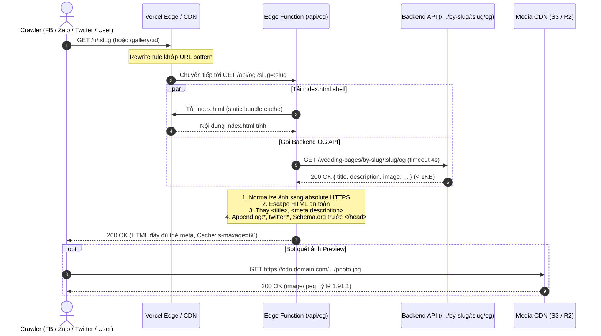

# Hướng Dẫn Tích Hợp Dynamic Open Graph (Angular SPA + Edge Function + Backend OG Endpoint)

> **Mục tiêu tài liệu:** Cung cấp hướng dẫn kiến trúc, luồng hoạt động (flow), đặc tả kỹ thuật và mã nguồn mẫu chuẩn để các AI Agent hoặc lập trình viên tích hợp tính năng **Dynamic Open Graph & Social Share Preview (Facebook, Zalo, Twitter/X, Telegram, iMessage...)** cho các dự án Web SPA (Angular/React/Vue) mà **không cần dựng Full SSR (Angular Universal)**.

---

## 1. Tổng quan bài toán & Kiến trúc giải pháp

### 1.1. Vấn đề của SPA truyền thống

1. **Client-side Rendering (CSR):** Các ứng dụng Angular/React SPA thông thường chỉ có một file `index.html` tĩnh với thẻ `<title>` và `<meta>` cố định. Dữ liệu trang chỉ được render sau khi JavaScript tải về và thực thi trên trình duyệt.
2. **Hành vi của Crawler / Bot mạng xã hội:**
   - Các bot mạng xã hội (Facebook `facebookexternalhit`, Zalo `ZaloBot`, Twitter/X `Twitterbot`, Telegram `TelegramBot`, LinkedIn...) **không chạy JavaScript** hoặc có cơ chế timeout rất chặt chẽ (chỉ chờ **2–3 giây**).
   - Khi người dùng chia sẻ một link chi tiết (ví dụ: `/u/:slug`, `/gallery/:id`, `/album/:code`), bot chỉ đọc file `index.html` tĩnh rỗng ban đầu. Hậu quả là bản preview bị trắng ảnh, hiển thị sai tiêu đề và mô tả của trang chủ.
3. **Nhược điểm nếu dùng Full SSR (Angular Universal / Server-Side Rendering):**
   - Phức tạp hoá quy trình build và deploy.
   - Tốn tài nguyên server (phải duy trì tiến trình Node.js render DOM liên tục, rủi ro leak memory).
   - Mất đi tính kinh tế và tốc độ phân phối toàn cầu của Static CDN Hosting (Vercel, Cloudflare Pages, S3/CloudFront).

---

### 1.2. Kiến trúc giải pháp tối ưu: Edge Function Shell Injection

Thay vì render toàn bộ cây DOM component của Angular trên server, chúng ta sử dụng kiến trúc **3 lớp siêu nhẹ**:

```
[Social Bot / Trình duyệt]
           │
           ▼
[1. Edge Router / CDN (Vercel / Cloudflare Worker)]
    ├─ Đường dẫn tĩnh / asset  ──► Trả trực tiếp từ CDN Cache
    └─ Đường dẫn chia sẻ (/u/:slug, /gallery/:id)
           │
           ▼
[2. Edge Function Proxy (api/og.ts)]
    ├─ 1. Tải static `index.html` shell (từ build cache)
    ├─ 2. Gọi Backend OG Endpoint siêu nhẹ (< 1KB)
    ├─ 3. Escape HTML & Inject thẻ `og:*`, `twitter:*`, JSON-LD vào `index.html`
    └─ 4. Trả về HTML đã hoàn thiện thẻ Meta (TTFB < 150ms, Cache 60s)
           │
           ▼ (chỉ khi có request từ Edge)
[3. Backend OG Endpoint (GET /.../:slug/og)]
    └─ Chỉ SELECT các cột cần thiết (slug, title, image, metadata), trả JSON < 1KB
```

#### Ưu điểm vượt trội:
- **Tốc độ cực nhanh (TTFB ~100–150ms):** Hoàn toàn triệt tiêu nguy cơ mạng xã hội bị timeout preview.
- **Tiết kiệm tài nguyên:** Backend không phải tải các payload nặng (JSON lớn, relation phức tạp), chỉ query index lookup < 15ms.
- **Fallback an toàn 100%:** Nếu Backend lỗi hoặc timeout, Edge Function trả về file `index.html` nguyên bản. Trình duyệt client vẫn tải SPA bình thường và tự điều hướng xử lý lỗi.
- **Vẫn dùng Static Hosting:** Dự án Angular vẫn deploy dạng static build thông thường.

---

## 2. Sơ đồ luồng hoạt động (Sequence Flow)

### 2.1. Luồng khi Bot mạng xã hội hoặc Trình duyệt truy cập link chia sẻ



---

### 2.2. Luồng khi người dùng tương tác trong ứng dụng SPA (Client-side Routing)

Khi người dùng đã ở trong Webapp và bấm chuyển trang (không tải lại toàn bộ trang HTML):
1. Angular Router kích hoạt Component tương ứng (ví dụ: `PublicPage` hoặc `GalleryDetailPage`).
2. Component hoặc Guard gọi `OgMetaService` (sử dụng `Meta` và `Title` của `@angular/platform-browser`).
3. `OgMetaService` cập nhật DOM trên client để đảm bảo nếu người dùng copy link hoặc dùng các tiện ích mở rộng trình duyệt thì metadata vẫn luôn đồng bộ.

---

## 3. Đặc tả Backend OG Endpoint

### 3.1. Nguyên tắc thiết kế
1. **Endpoint công khai:** Không yêu cầu xác thực Bearer token / Session cookie.
2. **Kích thước siêu nhỏ (< 1KB):** Không trả về toàn bộ thực thể (Entity) hay các mảng quan hệ (relations/sections) lớn.
3. **Database Indexing:** Bắt buộc có composite index `(is_published, slug)` hoặc `(status, id)` để truy vấn đạt tốc độ < 15ms.
4. **Header Cache:** Bắt buộc có header:
   ```http
   Cache-Control: public, s-maxage=60, stale-while-revalidate=300
   ```
   *Giúp Edge Function và proxy CDN tái sử dụng kết quả, bảo vệ database khi bị hàng nghìn bot quét đồng thời.*

### 3.2. Response Contract chuẩn

```typescript
export interface IOgResponse {
  /** Slug hoặc ID định danh */
  slug: string;
  /** Tiêu đề hiển thị khi chia sẻ (khuyến nghị <= 70 ký tự) */
  title: string;
  /** Mô tả ngắn / Lời mời (khuyến nghị 100 - 250 ký tự, tối đa 300 ký tự) */
  description: string;
  /** Đường dẫn ảnh (storage path R2/S3 hoặc URL tuyệt đối) */
  image: string;
  /** MIME type của ảnh: 'image/jpeg' | 'image/png' | 'image/webp' */
  imageType?: string;
  /** Trạng thái xuất bản */
  isPublished: boolean;
}
```

### 3.3. Ma trận Fallback dữ liệu tại Backend Service

Luôn tuân theo thứ tự ưu tiên giảm dần để đảm bảo **không bao giờ trả về dữ liệu rỗng**:

| Trường dữ liệu | Mức 1: Cấu hình riêng (Custom OG) | Mức 2: Dữ liệu nghiệp vụ chung | Mức 3: Tự động trích xuất nội dung | Mức 4: Giá trị mặc định cuối |
| :--- | :--- | :--- | :--- | :--- |
| **`title`** | Cấu hình do người dùng tự nhập | Tên đối tượng chính (VD: Tên dâu rể, tên Album) | Trích từ tiêu đề section đầu tiên | `Tên dự án — Khám phá chi tiết` |
| **`description`** | Lời mô tả tùy chỉnh | Mô tả ngắn / Tóm tắt nội dung | Trích xuất câu trích dẫn / subtitle | `Trân trọng kính mời bạn xem chi tiết tại ${SITE_NAME}.` |
| **`image`** | Ảnh được chọn riêng cho mạng xã hội | Ảnh bìa đại diện (Cover/Hero) | Quét tìm ảnh đầu tiên trong danh sách ảnh | Ảnh fallback mặc định của hệ thống (`assets/brand/default-og.jpg`) |
| **`imageType`** | Suy từ đuôi file (`.webp` $\rightarrow$ `image/webp`, `.png` $\rightarrow$ `image/png`, còn lại `image/jpeg`) | Mặc định `image/jpeg` | | |

### 3.4. Mã nguồn mẫu Backend (NestJS Controller & Service)

#### Controller
```typescript
import { Controller, Get, Param, NotFoundException, Header } from '@nestjs/common';
import { plainToInstance } from 'class-transformer';

@Controller('wedding-pages')
export class WeddingPagesController {
  constructor(private readonly pagesService: WeddingPagesService) {}

  @Get('by-slug/:slug/og')
  @Header('Cache-Control', 'public, s-maxage=60, stale-while-revalidate=300')
  async getOgBySlug(@Param('slug') slug: string): Promise<WeddingPageOgRO> {
    const ogData = await this.pagesService.getOgBySlug(slug);
    if (!ogData || !ogData.isPublished) {
      throw new NotFoundException({
        code: 'ERR_PAGE_NOT_FOUND',
        error: 'Page not found or not published',
      });
    }
    return plainToInstance(WeddingPageOgRO, ogData, { excludeExtraneousValues: true });
  }
}
```

#### Service
```typescript
async getOgBySlug(slug: string): Promise<WeddingPageOgRO | null> {
  // Chỉ SELECT các cột cần thiết cho việc tạo thẻ Open Graph
  const page = await this.repo.findOne({
    where: { slug, published: true },
    select: ['slug', 'config', 'sections', 'published'],
  });

  if (!page) return null;

  const customOg = page.config?.og;
  const sharedInfo = page.config?.sharedInfo;
  
  // 1. Xác định Title
  const entityTitle = sharedInfo?.title || `${sharedInfo?.groomName} & ${sharedInfo?.brideName}`;
  const title = (customOg?.title?.trim() || (entityTitle ? `${entityTitle} — Thiệp cưới` : `${slug} — Thiệp cưới`)).slice(0, 100);

  // 2. Xác định Description
  const defaultDesc = `Trân trọng kính mời bạn đến chung vui cùng chúng tôi. Bấm vào để xem chi tiết.`;
  const description = (customOg?.description?.trim() || sharedInfo?.subtitle || defaultDesc).slice(0, 300);

  // 3. Xác định Image
  const rawImage = customOg?.image?.trim() || page.config?.coverImage || '';
  let imageType = 'image/jpeg';
  if (rawImage.endsWith('.webp')) imageType = 'image/webp';
  else if (rawImage.endsWith('.png')) imageType = 'image/png';

  return {
    slug: page.slug,
    title,
    description,
    image: rawImage,
    imageType,
    isPublished: Boolean(page.published),
  };
}
```

---

## 4. Đặc tả Tiêu chuẩn Ảnh Open Graph (`og:image`)

Mạng xã hội (đặc biệt là Facebook và Zalo) có các thuật toán khắt khe khi quét ảnh:

1. **Tỷ lệ khung hình chuẩn:** **`1.91 : 1`** (Kích thước khuyến nghị: **`1200 x 630 px`** hoặc **`2000 x 1047 px`**).
   - Tỷ lệ này đảm bảo hiển thị dạng khung chữ nhật lớn toàn chiều ngang trên bảng tin (feed) của cả điện thoại và máy tính.
   - Nếu tỷ lệ ảnh quá vuông hoặc dọc, Facebook/Zalo sẽ thu nhỏ thành ô vuông nhỏ bên góc trái.
2. **Kích thước tối thiểu:** `600 x 315 px`. Ảnh dưới `200 x 200 px` sẽ bị Facebook từ chối hiển thị.
3. **Dung lượng tệp:** Khuyến nghị **< 300 KB** (tối đa 5 MB). Ảnh quá nặng sẽ khiến bot crawler bị timeout khi tải ảnh để tạo thumbnail.
4. **URL ảnh:** Bắt buộc là **HTTPS tuyệt đối** (Absolute URL). Bot không thể hiểu các đường dẫn tương đối như `/assets/...` hay storage key nội bộ `bucket/photos/...`.

---

## 5. Triển khai Frontend & Edge Function (Vercel)

### 5.1. Cấu hình Rewrite URL (`vercel.json`)

Khai báo rewrite để khi có request đến URL chia sẻ, Vercel chuyển tiếp ngầm đến Edge Function:

```json
{
  "$schema": "https://openapi.vercel.sh/vercel.json",
  "framework": "angular",
  "rewrites": [
    { "source": "/u/:slug", "destination": "/api/og?slug=:slug" },
    { "source": "/((?!api/|assets/|favicon\\.ico).*)", "destination": "/index.html" }
  ]
}
```

---

### 5.2. Edge Function Handler (`api/og.ts`)

Edge Function chạy trên Vercel Edge Runtime (V8 isolates), khởi động tức thì 0ms:

```typescript
import { buildOgMeta, injectOgMeta, type IOgPageInput } from './_lib/og-meta.js';

export const config = {
  runtime: 'edge',
};

const DEFAULT_API_BASE_URL = 'https://api.domain.com';
const DEFAULT_CDN_BASE_URL = 'https://cdn.domain.com';
const SLUG_PATTERN = /^[a-z0-9]+(-[a-z0-9]+)*$/i;

const CACHE_HEADERS = {
  'content-type': 'text/html; charset=utf-8',
  'cache-control': 'public, s-maxage=60, stale-while-revalidate=300',
};

export async function GET(request: Request): Promise<Response> {
  const requestUrl = new URL(request.url);
  const host = request.headers.get('x-forwarded-host') ?? requestUrl.host;
  const origin = `https://${host}`;
  const slug = requestUrl.searchParams.get('slug') ?? '';

  // 1. Tải file index.html đã deploy (có kèm hash bundle)
  const shellHeaders: Record<string, string> = { cookie: request.headers.get('cookie') ?? '' };
  const bypass = process.env['VERCEL_AUTOMATION_BYPASS_SECRET'];
  if (bypass) shellHeaders['x-vercel-protection-bypass'] = bypass;

  const shell = await fetch(`${origin}/index.html`, { headers: shellHeaders });
  if (!shell.ok) return new Response('index.html unavailable', { status: 502 });
  const html = await shell.text();

  // Validate slug cơ bản
  if (!slug || slug.length > 128 || !SLUG_PATTERN.test(slug)) {
    return new Response(html, { status: 200, headers: CACHE_HEADERS });
  }

  const apiBase = (process.env['API_BASE_URL']?.trim() || DEFAULT_API_BASE_URL).replace(/\/+$/, '');
  const cdnBase = (process.env['CDN_BASE_URL']?.trim() || DEFAULT_CDN_BASE_URL).replace(/\/+$/, '');

  try {
    // 2. Gọi Backend OG Endpoint (giới hạn timeout 4 giây)
    const apiUrl = `${apiBase}/wedding-pages/by-slug/${encodeURIComponent(slug)}/og`;
    const res = await fetch(apiUrl, {
      headers: { accept: 'application/json' },
      signal: AbortSignal.timeout(4000),
    });

    // Nếu slug không tồn tại (404), vẫn trả HTML để SPA hiển thị giao diện báo lỗi
    if (!res.ok) {
      return new Response(html, { status: res.status === 404 ? 404 : 200, headers: CACHE_HEADERS });
    }

    const page = (await res.json()) as IOgPageInput;

    // 3. Inject thẻ meta vào index.html
    const enrichedHtml = injectOgMeta(html, buildOgMeta(page, origin, cdnBase));
    return new Response(enrichedHtml, {
      status: 200,
      headers: CACHE_HEADERS,
    });
  } catch (err) {
    // 4. Fallback an toàn: Khi backend timeout hoặc gặp lỗi, vẫn trả HTML gốc không crash
    return new Response(html, {
      status: 200,
      headers: { ...CACHE_HEADERS, 'cache-control': 'no-store' },
    });
  }
}

export async function HEAD(request: Request): Promise<Response> {
  const res = await GET(request);
  return new Response(null, { status: res.status, headers: res.headers });
}
```

---

### 5.3. Thư viện Helper tạo Meta & Escape HTML (`api/_lib/og-meta.ts`)

```typescript
export interface IOgMeta {
  title: string;
  description: string;
  url: string;
  image: string;
  imageType?: string;
  jsonLd?: string;
}

export interface IOgPageInput {
  slug: string;
  title?: string;
  description?: string;
  image?: string;
  imageType?: string;
}

const SITE_NAME = 'Wedding+';
const DEFAULT_CDN_BASE = 'https://cdn.domain.com';

/** Thoát các ký tự đặc biệt để chống XSS và vỡ cú pháp HTML */
export function escapeHtml(value: string): string {
  return value
    .replace(/&/g, '&amp;')
    .replace(/</g, '&lt;')
    .replace(/>/g, '&gt;')
    .replace(/"/g, '&quot;')
    .replace(/'/g, '&#39;');
}

export function getImageMimeType(url: string): string {
  const pathname = url.split('?')[0].toLowerCase();
  if (pathname.endsWith('.png')) return 'image/png';
  if (pathname.endsWith('.webp')) return 'image/webp';
  if (pathname.endsWith('.gif')) return 'image/gif';
  return 'image/jpeg';
}

/** Chuyển đường dẫn thành URL HTTPS tuyệt đối */
export function toAbsoluteUrl(raw: string, origin: string, cdnBase = DEFAULT_CDN_BASE): string {
  const value = raw.trim();
  if (!value) return '';

  if (value.startsWith('http://') || value.startsWith('https://')) return value;
  if (value.startsWith('//')) return `https:${value}`;

  // File lưu trữ trên Cloud Storage / CDN
  if (!value.startsWith('assets/')) {
    const cleanKey = value.replace(/^\/+/, '');
    const cleanCdn = (cdnBase || DEFAULT_CDN_BASE).replace(/\/+$/, '');
    return `${cleanCdn}/${cleanKey}`;
  }

  // File tĩnh cục bộ thuộc web host
  try {
    const url = new URL(value, origin.replace(/\/+$/, '') + '/');
    return url.toString();
  } catch {
    return '';
  }
}

export function buildOgMeta(page: IOgPageInput, origin: string, cdnBase = DEFAULT_CDN_BASE): IOgMeta {
  const title = page.title || `${page.slug} — ${SITE_NAME}`;
  const description = page.description || `Xem chi tiết trên ${SITE_NAME}.`;
  const pageUrl = `${origin}/u/${encodeURIComponent(page.slug)}`;
  const fullImage = page.image ? toAbsoluteUrl(page.image, origin, cdnBase) : '';

  // Dựng cấu trúc Schema.org JSON-LD
  const jsonLdObj: Record<string, unknown> = {
    '@context': 'https://schema.org',
    '@type': 'WebPage',
    name: title,
    description: description.slice(0, 300),
    url: pageUrl,
  };
  if (fullImage) {
    jsonLdObj['image'] = [fullImage];
  }

  return {
    title,
    description: description.slice(0, 300),
    url: pageUrl,
    image: fullImage,
    imageType: fullImage ? getImageMimeType(fullImage) : undefined,
    jsonLd: JSON.stringify(jsonLdObj).replace(/<\/script/gi, '<\\/script'),
  };
}

/** Thay thế <title>, <meta description> và chèn bộ thẻ Open Graph vào trước thẻ đóng </head> */
export function injectOgMeta(html: string, meta: IOgMeta): string {
  const t = escapeHtml(meta.title);
  const d = escapeHtml(meta.description);
  const u = escapeHtml(meta.url);
  const i = meta.image ? escapeHtml(meta.image) : '';
  const it = meta.imageType || 'image/jpeg';

  const tags = [
    `<meta property="og:type" content="website">`,
    `<meta property="og:site_name" content="${SITE_NAME}">`,
    `<meta property="og:locale" content="vi_VN">`,
    `<meta property="og:url" content="${u}">`,
    `<meta property="og:title" content="${t}">`,
    `<meta property="og:description" content="${d}">`,
    i && `<meta property="og:image" content="${i}">`,
    i && `<meta property="og:image:secure_url" content="${i}">`,
    i && `<meta property="og:image:type" content="${it}">`,
    i && `<meta property="og:image:alt" content="${t}">`,
    `<meta name="twitter:card" content="${i ? 'summary_large_image' : 'summary'}">`,
    `<meta name="twitter:title" content="${t}">`,
    `<meta name="twitter:description" content="${d}">`,
    i && `<meta name="twitter:image" content="${i}">`,
    `<link rel="canonical" href="${u}">`,
    meta.jsonLd && `<script type="application/ld+json">${meta.jsonLd}</script>`,
  ]
    .filter(Boolean)
    .join('\n  ');

  return html
    .replace(/<title>[\s\S]*?<\/title>/i, () => `<title>${t}</title>`)
    .replace(/<meta\s+name="description"[^>]*>/i, () => `<meta name="description" content="${d}">`)
    .replace('</head>', () => `  ${tags}\n</head>`);
}
```

---

### 5.4. Đồng bộ trong Angular Client (`OgMetaService`)

Để đồng bộ thẻ trên client khi người dùng click điều hướng trang trong SPA:

```typescript
import { Injectable } from '@angular/core';
import { Title, Meta } from '@angular/platform-browser';

export interface IClientMeta {
  title: string;
  description: string;
  url: string;
  image?: string;
}

@Injectable({ providedIn: 'root' })
export class OgMetaService {
  constructor(
    private readonly titleService: Title,
    private readonly metaService: Meta
  ) {}

  setMeta(data: IClientMeta): void {
    this.titleService.setTitle(data.title);
    this.metaService.updateTag({ name: 'description', content: data.description });

    this.metaService.updateTag({ property: 'og:title', content: data.title });
    this.metaService.updateTag({ property: 'og:description', content: data.description });
    this.metaService.updateTag({ property: 'og:url', content: data.url });

    if (data.image) {
      this.metaService.updateTag({ property: 'og:image', content: data.image });
      this.metaService.updateTag({ property: 'og:image:secure_url', content: data.image });
      this.metaService.updateTag({ name: 'twitter:image', content: data.image });
      this.metaService.updateTag({ name: 'twitter:card', content: 'summary_large_image' });
    }
    this.metaService.updateTag({ name: 'twitter:title', content: data.title });
    this.metaService.updateTag({ name: 'twitter:description', content: data.description });
  }
}
```

---

## 6. Hướng dẫn Kiểm thử & Xác minh (Verification Checklist)

### 6.1. Kiểm tra nhanh bằng dòng lệnh cURL

#### 1. Kiểm tra với User-Agent Facebook Crawler
```bash
curl -s -L -A "facebookexternalhit/1.1 (+http://www.facebook.com/externalhit_uatext.php)" "https://your-domain.com/u/your-slug" | grep -iE "<meta property=\"og:|<meta name=\"twitter:|<title"
```

#### 2. Kiểm tra với User-Agent Zalo Bot
```bash
curl -s -L -A "Mozilla/5.0 (compatible; ZaloBot/1.0; +http://zalo.me)" "https://your-domain.com/u/your-slug" | grep -iE "<meta property=\"og:|<meta name=\"twitter:|<title"
```

#### 3. Đo tốc độ phản hồi (TTFB)
```bash
curl -o /dev/null -s -w 'HTTP Status: %{http_code}\nTTFB: %{time_starttransfer}s\nTotal Time: %{time_total}s\n' "https://your-domain.com/u/your-slug"
```
*Kết quả đạt chuẩn: `HTTP Status: 200`, `TTFB < 0.25s`.*

---

### 6.2. Kiểm tra bằng công cụ chính thức của mạng xã hội

1. **Facebook Sharing Debugger:**
   - Truy cập: [https://developers.facebook.com/tools/debug/](https://developers.facebook.com/tools/debug/)
   - Nhập URL cần kiểm tra và bấm **Fetch new scrape information** (hoặc **Scrape Again** để xóa cache cũ).
   - Xác nhận:
     - Thẻ `og:image` hiển thị ảnh lớn toàn chiều ngang.
     - Không có cảnh báo thiếu thuộc tính (`Missing Properties`).
2. **Kiểm tra trên Zalo / iMessage / Telegram:**
   - Gửi đường link vào khung chat riêng.
   - **Mẹo vượt cache khi debug:** Thêm tham số truy vấn ngẫu nhiên phía sau link:
     `https://your-domain.com/u/your-slug?v=1` hoặc `?t=123456`.

---

## 7. Các cạm bẫy thường gặp (Common Pitfalls & Gotchas)

| Vấn đề gặp phải | Nguyên nhân | Cách khắc phục |
| :--- | :--- | :--- |
| **Ảnh không hiển thị trên Zalo/Facebook** | Đường dẫn ảnh là đường dẫn tương đối (VD: `/assets/cover.jpg`) hoặc storage key (VD: `uploads/photo.jpg`). | Hàm `toAbsoluteUrl()` bắt buộc phải biến đổi đường dẫn thành URL tuyệt đối có `https://`. |
| **Vỡ layout thẻ Meta / XSS** | Tên dâu rể hoặc tiêu đề có dấu `&`, `<`, `"`, `'`. | Luôn đi qua hàm `escapeHtml()` trước khi chèn vào chuỗi HTML. |
| **Bot mạng xã hội bị timeout** | Edge Function gọi Backend API mất hơn 3 giây do câu truy vấn nặng. | Đặt `AbortSignal.timeout(4000)`, tối ưu DB query chỉ lấy cột cần thiết và bổ sung header HTTP Cache `s-maxage=60`. |
| **Trang xem trước (Vercel Preview) không cào được** | Tính năng *Vercel Deployment Protection* chặn truy cập bằng mã HTTP `401 Unauthorized`. | Cấu hình forward header `x-vercel-protection-bypass` hoặc kiểm thử trên môi trường Production / Public Domain. |
| **Facebook vẫn hiện thông tin cũ sau khi sửa** | Facebook CDN lưu cache metadata của link theo chu kỳ 7 ngày. | Truy cập Facebook Sharing Debugger bấm nút **Scrape Again** để xóa cache. |

---

## 8. Kế hoạch tối ưu hoá hiệu năng sinh ảnh OG (Performance Optimization)

Để tìm hiểu chi tiết các giải pháp tăng tốc độ sinh ảnh OG động, triệt tiêu cold-start, tối ưu hóa Edge CDN Caching và lộ trình triển khai theo từng pha, tham khảo tài liệu riêng:
👉 **[Kế hoạch tối ưu hoá tốc độ sinh ảnh Open Graph](og-optimization-plan.md)**

