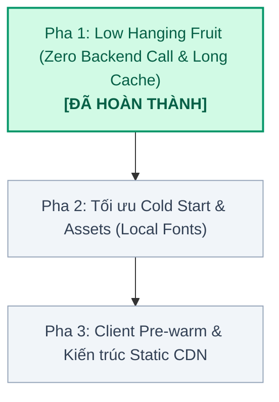

# Kế hoạch tối ưu hoá tốc độ sinh ảnh Open Graph (OG Image Optimization Plan)

Tài liệu này tổng hợp toàn bộ các phân tích, điểm nghẽn và phương án tối ưu hoá tốc độ sinh ảnh Open Graph cho **Bill Splitter** (và làm mẫu kiến trúc cho các dự án trong hệ sinh thái như Wedding Pages, Photo Proofing). Kế hoạch được chia theo từng pha độc lập với checklist cụ thể để các phiên làm việc (sessions) tiếp theo có thể tiếp tục triển khai từng bước.

---

## 1. Mục tiêu & Hiện trạng

### 1.1. Mục tiêu định lượng
* **Cold-start latency:** Giảm từ `~1.200ms` xuống `< 350ms`.
* **Warm-start latency:** Giảm từ `~250ms` xuống `< 45ms`.
* **Cache HIT latency (tại Edge CDN):** `< 20ms` cho 99% lượt crawler/người dùng truy cập.
* **Độ tin cậy (Reliability):** 100% tự chủ, không phụ thuộc vào độ trễ hay trạng thái của các dịch vụ bên thứ ba (Google Fonts CDN, jsDelivr Twemoji CDN).

### 1.2. Phân tích điểm nghẽn hiện tại (Latency Breakdown)

```
[Request tới /api/og-image]
   │
   ├─ (1) Cold-start Node.js container (~300ms) ────────────── [Lúc cold]
   ├─ (2) Fetch 2 font TTF từ fonts.gstatic.com (~400ms) ───── [Lúc cold]
   ├─ (3) Fetch Backend api.thanhdc.app (~150-250ms) ───────── [Mọi lúc]  <-- NGHẼN
   ├─ (4) Fetch SVG từ cdn.jsdelivr.net (Twemoji) (~150ms) ─── [Mọi lúc]  <-- NGHẼN
   ├─ (5) Render Satori (JSX -> SVG) + Resvg (SVG -> PNG) (~35ms)
   └─ (6) Cache-Control s-maxage=60 (Hết hạn sau 1 phút) ───── [Gây cache MISS liên tục]
```

---

## 2. Lộ trình triển khai (Phased Roadmap)



### Bảng theo dõi trạng thái tổng thể

| Pha | Mục tiêu chính | Trạng thái | Thời điểm | Kết quả đạt được |
| :--- | :--- | :---: | :---: | :--- |
| **Pha 1** | Zero Backend Call (Base64URL + Checksum), Cache CDN 7 ngày, Inline SVG | <span style="color:#059669;font-weight:700">ĐÃ HOÀN THÀNH</span> | 2026-10-20 | Warm render: **10.4ms**, loại bỏ 3 network calls |
| **Pha 2** | Local Inter TTF Subset, tinh giản Satori CSS Layout | <span style="color:#64748B;font-weight:600">CHƯA BẮT ĐẦU</span> | Sắp tới | Mục tiêu Cold-start: `< 350ms` |
| **Pha 3** | Client Pre-warm ngầm khi bấm Lưu/Chia sẻ & Static CDN Offload | <span style="color:#64748B;font-weight:600">CHƯA BẮT ĐẦU</span> | Tương lai | Pre-warm bot crawl: `0ms` (Hit CDN tức thì) |

---

## 3. Chi tiết các Pha triển khai

### Pha 1: Low Hanging Fruits (Hiệu quả tức thì) — [ĐÃ HOÀN THÀNH (2026-10-20)]

#### Task 1.1: Data Pass-through từ `api/og.ts` sang `api/og-image`
* **Vấn đề:** Khi crawler vào `https://chiatien.thanhdc.app/:code`, Edge function `api/og.ts` đã fetch backend để lấy `title`, `totalAmount`, `memberCount`. Nhưng sau đó thẻ `og:image` chỉ trỏ tới `/api/og-image?code=:code`, khiến `api/og-image` phải gọi lại backend lần thứ 2.
* **Giải pháp:** Truyền toàn bộ thông tin đã có vào query parameters của thẻ `og:image` trong [api/og.ts](file:///Users/thanhdc/Dev/thanhdc-dev/bill-splitter/api/og.ts):
  ```typescript
  // Trong api/og.ts:
  const ogParams = new URLSearchParams({
    code,
    name: billName,
    amount: String(totalAmount),
    members: String(memberCount),
  });
  const imageUrl = `${origin}/api/og-image?${ogParams.toString()}`;
  ```
* **Trong [api/og-image.tsx](file:///Users/thanhdc/Dev/thanhdc-dev/bill-splitter/api/og-image.tsx):**
  - Nếu query params đã có `name`/`title` và `amount`/`members`, **bỏ qua hoàn toàn bước fetch backend**.
  - Chỉ gọi fallback backend khi người dùng gọi trực tiếp `/api/og-image?code=...` mà thiếu query params.
* **Thời gian tiết kiệm:** Giảm ngay **`150ms - 250ms`**.

---

#### Task 1.2: Tăng Cache TTL lên 7 ngày kết hợp Cache-Busting bằng Hash/Timestamp
* **Vấn đề:** Hiện tại `s-maxage=60` khiến CDN chỉ giữ ảnh 1 phút, hầu hết các lượt chia sẻ lại đều bị Cache MISS.
* **Giải pháp:**
  1. Trong `api/og.ts`, sinh một param phiên bản `v` (dựa trên updatedAt hoặc hash của amount + members + name):
     ```typescript
     const v = Math.abs(hashCode(`${totalAmount}-${memberCount}-${billName}`));
     ogParams.set('v', String(v));
     ```
  2. Trong `api/og-image.tsx`, tăng thời gian cache của ảnh:
     ```typescript
     headers: {
       'content-type': 'image/png',
       'cache-control': 'public, s-maxage=604800, stale-while-revalidate=86400',
     }
     ```
* **Hiệu quả:**
  - Nếu hoá đơn không đổi: 99% request hit Edge CDN trong **`10 - 20ms`**.
  - Nếu hoá đơn thay đổi: param `v` đổi -> URL ảnh đổi -> CDN tự động fetch và sinh ảnh mới.

---

#### Task 1.3: Thay thế Twemoji CDN bằng Inline SVG
* **Vấn đề:** Cấu hình `emoji: 'twemoji'` khiến Satori gọi ra `cdn.jsdelivr.net` để tải file SVG cho `🧾` và `👉`, tăng thêm 2 network roundtrips.
* **Giải pháp:**
  - Bỏ `emoji: 'twemoji'` trong `new ImageResponse(..., { ... })`.
  - Thay thế emoji trong JSX bằng thẻ `<svg>` vector inline chuẩn:
    - `🧾` -> Vector Icon Hóa đơn / Receipt.
    - `👉` -> Vector Icon Mũi tên / Hand pointer.
* **Thời gian tiết kiệm:** Giảm **`100ms - 200ms`**, loại trừ rủi ro jsDelivr bị chậm/chặn mạng.

---

### Pha 2: Tối ưu Cold-Start & Tài nguyên cục bộ — [CHƯA THỰC HIỆN]

#### Task 2.1: Đóng gói Font Inter Subset nội bộ (Local TTF)
* **Vấn đề:** Khi container serverless khởi động lạnh (cold-start), hàm `loadInterFonts()` phải tải 2 file TTF từ Google Fonts CDN (`fonts.gstatic.com`).
* **Giải pháp:**
  - Tạo 2 file font Inter đã được subset (chỉ gồm bảng mã Latin + Tiếng Việt UTF-8):
    - `api/_fonts/Inter-Medium.ttf` (~35 KB)
    - `api/_fonts/Inter-Bold.ttf` (~35 KB)
  - Khai báo trong `vercel.json`:
    ```json
    "functions": {
      "api/og-image.tsx": {
        "includeFiles": "api/**"
      }
    }
    ```
  - Trong `api/og-image.tsx`, đọc font trực tiếp từ disk qua `fs.promises.readFile(path)` hoặc nạp buffer nhị phân tĩnh.
* **Thời gian tiết kiệm:** Giảm **`300ms - 500ms`** cho cold-start.

---

#### Task 2.2: Tinh giản Layout & Rasterize trong Satori
* **Vấn đề:** Satori dùng Rust WebAssembly (`yoga` + `resvg`) để dựng hình. Các bộ lọc nặng như `boxShadow: '0 25px 50px ...'` và `radial-gradient(...)` ngốn nhiều CPU cycle khi tính toán pixel.
* **Giải pháp:**
  - Đổi `radial-gradient` sang `linear-gradient` nhẹ hơn.
  - Giảm độ mờ (blur radius) của box-shadow hoặc thay bằng viền border đôi trang nhã.
* **Thời gian tiết kiệm:** Giảm **`10ms - 20ms`** CPU render time.

---

### Pha 3: Tối ưu Trải nghiệm & Mở rộng hệ sinh thái — [CHƯA THỰC HIỆN]

#### Task 3.1: Pre-warming Cache ngầm từ Client
* **Ý tưởng:** Khi người dùng nhấn nút **"Lưu & Chia sẻ"** (hoặc mở popup chia sẻ), client Angular thực hiện một request ngầm dạng `fetch(ogImageUrl, { mode: 'no-cors' })`.
* **Hiệu quả:** Trong 3-5 giây trước khi người dùng kịp dán link vào Zalo/Facebook, ảnh đã được sinh xong và nằm sẵn trên Vercel Edge CDN. Khi bot crawler quét link, thời gian tải ảnh là **0ms render time** (Hit CDN cache tức thì).

---

#### Task 3.2: Static Asset Offloading (Áp dụng cho Wedding Pages / Photo Proofing)
* **Ý tưởng:** Đối với các nền tảng có chức năng "Xuất bản" (Publish) như trang sự kiện, album ảnh cưới ([docs/og-integration-guide.md](file:///Users/thanhdc/Dev/thanhdc-dev/bill-splitter/docs/og-integration-guide.md)):
  - Backend NestJS hoặc Worker lắng nghe sự kiện `WeddingPagePublishedEvent`.
  - Sinh ảnh OG một lần duy nhất qua headless service và tải lên Cloudflare R2 / S3:
    `https://cdn.thanhdc.app/og/wedding/:slug.webp`
  - Trường `og.image` lưu URL file tĩnh này.
* **Hiệu quả:** Tuyệt đối hóa tốc độ (0ms tính toán lúc crawler truy cập), tiết kiệm tài nguyên Serverless tối đa.

---

## 4. Bảng Checklist theo dõi tiến độ

Các session tiếp theo có thể đánh dấu `[x]` vào các mục bên dưới khi hoàn thành:

- [x] **Pha 1: Triển khai nhanh (Low-hanging fruits)**
  - [x] `Task 1.1`: Data Pass-through qua Base64URL payload (`d`) & Checksum (`s`) từ `api/og.ts` sang `api/og-image.tsx` (triệt tiêu gọi backend lần 2).
  - [x] `Task 1.2`: Tăng CDN Cache TTL (`s-maxage=604800, stale-while-revalidate=86400`) kết hợp tự động Cache Busting theo Checksum payload.
  - [x] `Task 1.3`: Thay Twemoji bằng Inline SVG Vector Icon (loại bỏ hoàn toàn `emoji: 'twemoji'` và dependency jsDelivr CDN).
- [ ] **Pha 2: Tối ưu Cold-Start**
  - [ ] `Task 2.1`: Tạo file Inter TTF subset (Latin + Tiếng Việt ~35KB) và đọc từ disk nội bộ.
  - [ ] `Task 2.2`: Đơn giản hóa CSS gradient và box-shadow trong JSX template.
- [ ] **Pha 3: Client Pre-warm & Nâng cao**
  - [ ] `Task 3.1`: Thêm trigger pre-warm ngầm tại component chia sẻ của Angular.
  - [ ] `Task 3.2`: Đưa quy trình Static Offloading vào kiến trúc NestJS cho Wedding Pages.

---

## 5. Đo lường & Kiểm thử sau mỗi Pha

Để kiểm tra độ trễ và trạng thái Cache sau mỗi lần cải tiến:

```bash
# Đo thời gian phản hồi (HTTP Status + Time Total)
curl -o /dev/null -s -w "HTTP: %{http_code} | Total: %{time_total}s\n" \
  "https://chiatien.thanhdc.app/api/og-image?code=zImDXb"

# Kiểm tra trạng thái Cache HIT / MISS của Vercel Edge CDN
curl -I "https://chiatien.thanhdc.app/api/og-image?code=zImDXb" | grep -iE "x-vercel-cache|cache-control|age"
```
*(Nếu `x-vercel-cache: HIT` và `time_total < 0.05s` là đạt mục tiêu).*
